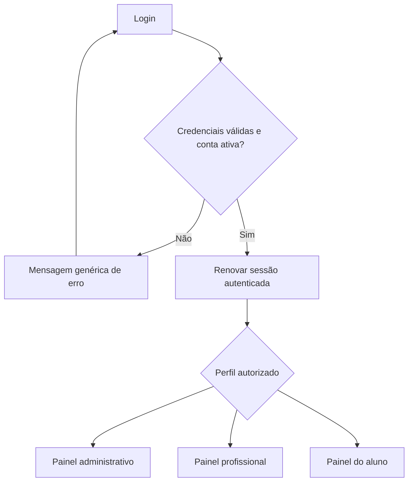
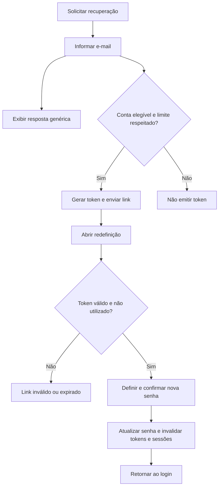

# Gestão de Academia — Briefing de implementação para o Codex

## 1. Missão imediata

Leia este documento e implemente a **Etapa 1 — Base** no repositório disponibilizado pelo usuário. Entregue código funcional, instruções de instalação e evidências dos testes possíveis. Não se limite a repetir o planejamento e não implemente o MVP inteiro nesta primeira tarefa.

Antes de editar, leia as instruções locais, incluindo eventuais arquivos AGENTS.md, verifique a estrutura existente e preserve alterações da dupla. Se houver código útil, adapte-o sem recriar o projeto. Não substitua as tecnologias escolhidas por outra stack para contornar limitações do ambiente.

Este documento consolida as decisões de produto e propõe detalhes técnicos para tornar a implementação executável. Estrutura de pastas, rotas e campos abaixo são uma base proposta, ajustável ao repositório; público, prioridade, prazo e tecnologias escolhidas devem ser preservados.

## 2. Contexto e decisões do projeto

| Item | Definição |
|---|---|
| Produto | Site de Gestão de Academia |
| Cliente principal | Redes de academias |
| Visão | Experiência integrada para administração, profissionais e alunos |
| Prioridade do MVP | Treinos e evolução dos alunos |
| Saúde no MVP | Avaliação física e histórico completo |
| Acesso | Site responsivo para celular e desktop |
| Equipe | Dois desenvolvedores |
| Entrega final | 22 de setembro de 2026 |
| Revisões planejadas | Quintas-feiras de 10 e 17 de setembro de 2026 |
| Nome comercial e identidade | Ainda não definidos; usar “Gestão de Academia” como nome provisório |

O problema central é organizar a prescrição e o acompanhamento dos treinos, mantendo avaliações e execuções consultáveis ao longo do tempo, dentro de uma rede com várias unidades.

O ciclo principal do MVP será: cadastrar aluno, vincular unidade e profissional, registrar avaliação, disponibilizar treino, registrar execução e consultar evolução. Não confundir visão de plataforma completa com escopo da primeira entrega.

## 3. Tecnologias

### Escolhas obrigatórias do usuário

- PHP para regras da aplicação e páginas renderizadas no servidor.
- HTML para estrutura das telas.
- CSS próprio para personalização visual.
- Bootstrap para componentes e responsividade; carregar o CSS próprio depois dele.

### Complementos previstos no planejamento

- MySQL para persistência, com PDO e consultas preparadas.
- JavaScript simples para interações necessárias.
- Git e GitHub para colaboração, conforme o repositório disponível.

Não introduzir React, Next.js, Supabase, Firebase, SPA, API separada ou framework PHP de grande porte sem necessidade e aprovação. Não exigir Node.js apenas para compilar o layout. Dependências pontuais, como envio SMTP, devem ser justificadas e documentadas.

Inspecionar as versões instaladas e registrar versões compatíveis no README. Não presumir XAMPP, Laragon, hospedagem, credenciais de banco ou SMTP. Se PHP/MySQL não estiverem disponíveis, preparar os arquivos, informar a limitação e fornecer passos de validação, sem declarar testes não executados como aprovados. Não migrar para SQLite como substituição silenciosa do MySQL.

## 4. Perfis e limites de acesso

| Perfil inicial | Responsabilidade |
|---|---|
| Administrador | Gerenciar cadastros e usuários dentro da rede autorizada |
| Profissional | Prescrever treinos e acompanhar apenas alunos autorizados |
| Aluno | Consultar seus dados e registrar a própria execução |

Gestor de unidade e recepção fazem parte da visão do produto, mas ficam simplificados nesta versão. Não conceder permissões de administrador a uma pessoa apenas por trabalhar na recepção. Cadastro administrativo não implica acesso a avaliações físicas.

Para a Etapa 1, adotar como simplificação proposta um perfil por conta e uma rede por conta. Permitir vínculos com unidades dessa rede. O modelo deverá permitir evolução posterior, sem implementar gestão complexa de permissões agora.

O administrador é da rede, não um superadministrador global. Todas as verificações devem ocorrer no servidor. Nunca confiar em IDs, rede, unidade ou perfil enviados pelo navegador sem validar o vínculo da sessão.

## 5. Escopo exato da Etapa 1

### Implementar agora

1. Estrutura inicial organizada e configuração por ambiente.
2. Conexão MySQL usando PDO e tratamento seguro de falhas.
3. Estrutura mínima do banco para redes, unidades, usuários, vínculos e recuperação de senha.
4. Login com e-mail e senha.
5. Sessão autenticada, bloqueio de rotas e redirecionamento por perfil.
6. Logout seguro.
7. Solicitação e conclusão de recuperação de senha.
8. Três painéis iniciais, com layout compartilhado e conteúdo adequado a cada perfil.
9. Estados de erro, sucesso e acesso negado.
10. Dados fictícios de desenvolvimento, instalação documentada e testes da base.

### Não implementar agora

- CRUD completo de alunos, unidades e profissionais.
- Catálogo e editor de treinos, execução e gráficos.
- Formulários de avaliação física e imagens de evolução.
- Cadastro público, matrícula ou seleção de perfil no login.
- Pagamentos, catracas, chat, aulas coletivas, rankings, nutrição e relógios.
- Landing page comercial ou aplicativo nativo.

Os módulos futuros podem aparecer como texto “Disponível em uma próxima etapa”, sem links quebrados, botões que fingem funcionar ou números fictícios apresentados como reais.

## 6. Telas e comportamento da base

| Tela | Conteúdo e comportamento |
|---|---|
| Login | E-mail, senha, mostrar/ocultar senha, botão Entrar e link Esqueci minha senha. Perfil obtido do servidor. |
| Recuperar senha | E-mail e confirmação genérica, exista ou não a conta. |
| Redefinir senha | Token válido, nova senha, confirmação e mensagens de validação. |
| Painel administrativo | Nome do usuário, rede autorizada, unidades vinculadas quando aplicável e indicação dos módulos futuros. |
| Painel profissional | Nome, perfil, vínculos e estado inicial sem alunos ou treinos cadastrados. |
| Painel do aluno | Nome, perfil e informação de que o treino e a avaliação ainda não foram disponibilizados. |
| Acesso negado | Mensagem clara e retorno ao painel permitido. |

Utilizar português brasileiro na interface. A área autenticada deve ter identificação do sistema, usuário, perfil, navegação responsiva e saída. Não criar um seletor visual que permita assumir outro perfil.

### Fluxo de autenticação

### Fluxo de recuperação

## 7. Estrutura técnica proposta

Separar apresentação, regras e banco sem criar abstrações excessivas. A organização pode ser adaptada ao repositório existente.

| Caminho sugerido | Finalidade |
|---|---|
| `public/` | Única raiz pública, com ponto de entrada e arquivos CSS/JS |
| `app/Controllers/` | Receber requisições, validar fluxo e escolher resposta |
| `app/Services/` | Autenticação, recuperação de senha e envio de mensagens |
| `app/Repositories/` | Consultas PDO com filtros de autorização |
| `app/Views/` | Telas PHP e componentes compartilhados |
| `app/Support/` | Sessão, CSRF, escape, redirecionamento e configuração |
| `config/` | Configuração sem credenciais versionadas |
| `database/` | Schema ou migrações incrementais |
| `scripts/` | Inicialização e criação de usuários de desenvolvimento por CLI |
| `storage/` | Logs privados, fora da raiz pública e ignorados no Git |
| `tests/` | Testes e roteiro verificável da etapa |
| `.env.example` | Variáveis esperadas, sem segredos reais |
| `README.md` | Instalação, execução, testes e limitações |

Documentar como configurar `public/` como raiz do servidor. Não presumir que colocar todo o projeto dentro de uma pasta pública seja seguro. Evitar a necessidade de reescrita de URL sem fornecer configuração equivalente para o ambiente usado.

### Rotas lógicas propostas

| Método | Rota | Regra |
|---|---|---|
| GET | `/login` | Exibir formulário; autenticado segue ao painel |
| POST | `/login` | Validar CSRF, limite de tentativas e credenciais |
| POST | `/logout` | Exigir sessão e CSRF e encerrar sessão |
| GET e POST | `/recuperar-senha` | Formulário e solicitação |
| GET e POST | `/redefinir-senha` | Validar token e redefinir |
| GET | `/admin` | Somente administrador autorizado |
| GET | `/profissional` | Somente profissional autorizado |
| GET | `/aluno` | Somente aluno autorizado |

Não usar operações GET para alterar dados. Não aceitar redirecionamento arbitrário para URL externa.

## 8. Banco mínimo proposto

Não criar todas as tabelas futuras agora. Usar chaves estrangeiras e restrições para proteger os vínculos, além da validação no PHP.

| Entidade | Campos e responsabilidades propostos |
|---|---|
| Redes | Identificador, nome, status e datas |
| Unidades | Identificador, rede, nome, status e datas |
| Usuários | Identificador, rede, nome, e-mail normalizado, hash da senha, perfil, status, versão de sessão e datas |
| Vínculos com unidades | Usuário e unidade, com unicidade e garantia de pertencimento à mesma rede |
| Recuperação de senha | Usuário, hash do token, validade, utilização e criação |
| Controle de tentativas | Persistência suficiente para limitar login e recuperação entre requisições |

Para manter o login simples, a proposta inicial é e-mail único globalmente. Se o repositório já suportar contas em múltiplas redes, preservar o modelo existente e documentar como o contexto é selecionado com segurança.

Não armazenar senhas ou tokens de recuperação em texto puro no banco. Não registrar senha, cookie ou token em logs gerais. Contas e redes inativas não podem manter acesso. Em cada requisição autenticada, validar a conta e a versão de sessão para permitir revogação após troca de senha.

Disponibilizar inicialização de desenvolvimento com pelo menos uma conta por perfil e duas redes fictícias para testar isolamento. A criação de contas deve ocorrer por CLI ou procedimento privado, sem instalador público e sem credenciais universais de produção. Pedir senha no terminal ou recebê-la por configuração segura; não imprimir segredos em logs de execução compartilhados.

## 9. Segurança exigida na implementação

- Usar `password_hash()` e `password_verify()`; nunca algoritmos caseiros.
- Usar PDO com parâmetros preparados e credenciais de banco fora do Git.
- Renovar o identificador de sessão após login, usar cookies HttpOnly e SameSite e exigir Secure em produção HTTPS.
- Definir expiração de sessão e invalidar autenticação após redefinição de senha.
- Proteger formulários POST com CSRF, inclusive logout.
- Escapar saída HTML e validar entradas no servidor; validação JavaScript é complementar.
- Restringir consultas por rede e vínculo. Ocultar menus não é controle de acesso.
- Aplicar limite de tentativas a login e recuperação; tornar parâmetros configuráveis e testar bloqueio e liberação.
- Não revelar se o e-mail existe em mensagens de recuperação ou erros de autenticação.
- Gerar token criptograficamente aleatório, guardar apenas seu hash e limitar validade. Proposta: 30 minutos, configurável.
- Invalidar tokens anteriores quando apropriado e consumir o token de forma atômica na troca de senha, impedindo reutilização concorrente.
- Montar links de recuperação com uma URL base confiável configurada, não com cabeçalhos de host não validados.
- Usar envio SMTP configurável. Em desenvolvimento, pode haver uma caixa de saída privada fora de `public/`, habilitada explicitamente apenas no ambiente local. Nunca exibir o link na resposta pública.
- Não fingir envio real de e-mail se SMTP não estiver configurado; explicar o modo de teste no README e o requisito para produção.
- Não expor stack traces, credenciais ou SQL ao usuário final.

Esses itens são requisitos de engenharia para a base, não certificação de segurança ou de conformidade legal. Dados de avaliações físicas entrarão em etapa posterior e exigirão revisão de privacidade antes de uso real.

## 10. Direção visual proposta

A identidade final ainda não foi escolhida. Para avançar, usar uma interface administrativa sóbria com fundo claro, navegação em tom escuro e uma cor de ação consistente. Centralizar cores e espaçamentos no CSS próprio para facilitar personalização posterior.

- Usar componentes Bootstrap reais, sem reimplementar a biblioteca.
- Organizar login como formulário de acesso, sem landing page ou seção promocional.
- Priorizar leitura e navegação nos painéis, com estados vazios honestos.
- Garantir labels, foco visível, navegação por teclado e mensagens ligadas aos campos.
- Conferir celular e desktop, sem rolagem horizontal involuntária.
- Não inventar logotipo, nome comercial definitivo ou métricas de uma academia real.

## 11. Contexto das próximas etapas

### Etapa 2 — Cadastros

Unidades, usuários, alunos, objetivos e vínculo com profissional. O administrador organiza a rede; a visibilidade administrativa não libera dados de saúde automaticamente.

### Etapa 3 — Treinos

Catálogo de exercícios e fichas com séries, repetições, carga, descanso e orientações. O profissional trabalha a partir dos alunos autorizados.

### Etapa 4 — Execução

O aluno consulta a ficha, registra o realizado, conclui o treino e consulta seu histórico. Execuções devem referenciar a versão correta da ficha, sem alteração retroativa quando o profissional atualiza o treino.

### Etapa 5 — Avaliações e evolução

Registrar data, profissional, objetivos, peso, altura, medidas, testes e observações. Composição corporal, quando avaliada, registra o método utilizado. Comparar avaliações preservando as anteriores. Não gerar diagnósticos automáticos. Fotos são opcionais, não requisito da primeira entrega.

### Mapa geral de navegação futura

| Área | Navegação |
|---|---|
| Administrador | Painel → unidades; usuários e permissões; alunos → cadastro e vínculos |
| Profissional | Painel → meus alunos → resumo → treinos, avaliações ou evolução; catálogo de exercícios |
| Aluno | Painel → meu treino → execução → resumo; minha evolução → históricos e gráficos; meu perfil |

O mapa acima é contexto para evitar decisões que impeçam evolução. Não autoriza implementar esses módulos na Etapa 1.

## 12. Cronograma e trabalho em dupla

| Período | Meta planejada |
|---|---|
| 10/09/2026, quinta | Escopo, estrutura inicial, campos combinados e banco planejado |
| 11 a 16/09 | Desenvolvimento e integração do fluxo principal do MVP |
| 17/09/2026, quinta | Demonstração de cadastro, avaliação, treino, execução e histórico |
| 18 a 20/09 | Correções, responsividade, evolução e validação da publicação |
| 21/09 | Testes finais e preparação da apresentação |
| 22/09/2026, terça | Entrega final |

O cronograma é uma meta, não uma declaração de trabalho concluído. Se este documento for usado depois de um marco, registrar a situação real e propor ajuste sem alterar unilateralmente a data final.

Divisão proposta: uma pessoa cuida de HTML, Bootstrap, CSS e interações; a outra cuida de PHP, banco e autenticação. Ambos integram diariamente. Nomes, disponibilidade e nível técnico ainda não foram informados.

## 13. Critérios de aceite da Etapa 1

- [ ] Projeto instalado seguindo o README, sem depender de credenciais pessoais embutidas.
- [ ] Schema aplicado em banco de desenvolvimento sem apagar dados existentes.
- [ ] Login válido direciona cada um dos três perfis ao painel correto.
- [ ] Senha incorreta e conta inexistente geram resposta genérica.
- [ ] Conta ou rede inativa não acessa áreas autenticadas.
- [ ] Usuário não autenticado não abre painel protegido.
- [ ] Trocar URL ou parâmetros não permite assumir outro perfil ou rede.
- [ ] Logout invalida a sessão e o painel volta a exigir login.
- [ ] POST sem CSRF válido é rejeitado.
- [ ] Limites de tentativas são aplicados e verificáveis.
- [ ] Recuperação retorna resposta genérica e entrega o link pelo canal configurado.
- [ ] Token inválido, expirado ou já usado é recusado.
- [ ] Token válido altera a senha; senha antiga deixa de funcionar e sessões anteriores são revogadas.
- [ ] Telas funcionam em celular e desktop, com labels e foco visíveis.
- [ ] Painéis não apresentam dados inventados como reais nem ações futuras como prontas.
- [ ] Arquivos privados, configuração, logs e SQL não são servidos publicamente.

Testar ao menos uma conta por perfil e tentativas entre duas redes. Executar verificações de sintaxe PHP e testes de integração em banco de teste quando possível. Nunca executar testes destrutivos em banco real. Reportar testes executados, resultados e testes pendentes separadamente.

## 14. Entrega esperada do Codex

Ao finalizar, apresentar:

1. Resumo do que foi implementado na Etapa 1.
2. Estrutura do código e decisões técnicas relevantes.
3. README com requisitos, configuração, schema, contas de teste, execução e recuperação de senha.
4. `.env.example` ou configuração equivalente sem segredos.
5. Scripts seguros de preparação e testes.
6. Resultados das verificações e limitações reais do ambiente.
7. Próximo passo recomendado para iniciar os cadastros, sem implementá-los automaticamente.

Não contratar serviços, publicar o sistema, enviar e-mails reais ou alterar produção sem autorização específica. Não criar commits nem enviar alterações a um repositório remoto sem solicitação do usuário ou autorização explícita do fluxo em uso.

## 15. Instrução de início

Comece inspecionando o repositório e o ambiente, apresente um plano curto e implemente a Etapa 1. Tome decisões reversíveis compatíveis com este briefing. Pergunte apenas quando faltar uma informação que realmente bloqueie o trabalho ou quando houver conflito com o projeto existente. Se uma limitação impedir execução, avance no código e na documentação dentro do possível e informe exatamente o que ainda precisa ser validado. Não substitua PHP, HTML, CSS e Bootstrap.
